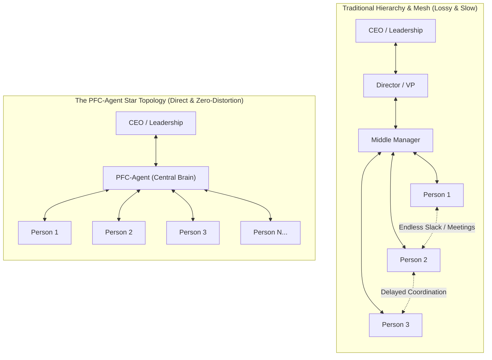
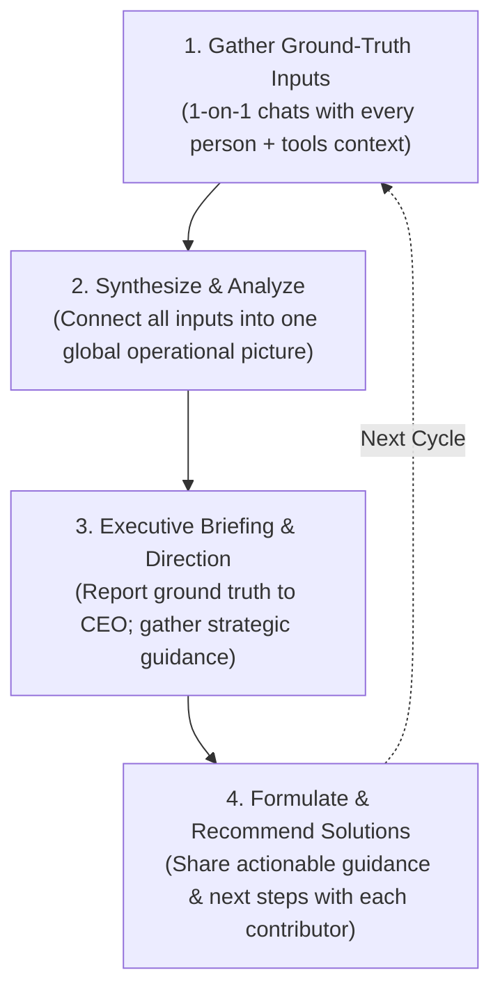

# PFC-Agent: The Prefrontal Cortex for Human Teams

> **Growing companies don't slow down because people get lazy. They slow down because getting many people to work together seamlessly is fundamentally hard.**  
> PFC-Agent is an AI that coordinates human teams—eliminating coordination friction, aligning daily priorities, and helping large organizations execute with the speed of a startup.

---

## The Universal Truth About Teamwork

When a team has 5 people in a single room, everyone communicates directly. Progress is clear, blockers are fixed instantly over lunch, and velocity is near-perfect.

When that team grows to 50, 500, or 5,000, execution stalls:
- **People get stuck silently:** Progress pauses while waiting for a decision, an answer, or an approval from another department.
- **Effort scatters:** Everyone works hard 10 hours a day, but individual tasks gradually drift out of alignment with the company's core goal.
- **Hierarchical distortion:** By the time ground-level realities filter up through 3–4 layers of managers to the CEO, the truth is delayed, diluted, and distorted.

---

## The Network Architecture: Star Topology vs. Chaotic Mesh

Why is coordination in large organizations so slow? It is a structural math problem.

In traditional organizations, information travels through a **chaotic mesh** or a **deep hierarchy**:
- To stay aligned, $N$ people need up to $N(N-1)/2$ communication pathways. Status meetings, endless Slack pings, and sync calls explode.
- In a hierarchy, a critical blocker on the ground takes days or weeks to climb up 4 layers of management and trickle back down. Information gets distorted at every handoff.

**PFC-Agent collapses this into an optimal Star Topology:**
- **No one needs to talk to 100 people.** Every employee and executive only has **one** structured, daily touchpoint: with PFC-Agent.
- **Zero communication distortion:** The ground reality reaches the core instantly without intermediate political filtering.
- **Zero dispatch delay:** High-context, actionable daily directives are routed straight to each individual contributor in seconds.

---

## How It Works: The 4-Step Executive Loop

Every single day, PFC-Agent runs a continuous, closed-loop coordination cycle:

### 1. Gather Ground-Truth Inputs (Chat with Everyone)
Every day, PFC-Agent conducts a brief 1-on-1 conversation with **every single person** in the organization.
- It learns what they accomplished, where their current task stands, and what specific roadblocks or dependencies they are facing.
- It combines their answers with background data from tools (commits, task status, messages) to establish ground truth.

### 2. Synthesize & Analyze (The Complete Puzzle)
No human manager has the time or bandwidth to synthesize updates from 50 or 500 people simultaneously. PFC-Agent does it in seconds:
- It aggregates ground realities from across engineering, product, sales, and operations.
- It identifies hidden conflicts, critical-path bottlenecks, duplicated work, and uncommunicated dependencies across the entire organization.

### 3. Executive Briefing & Strategic Guidance (Direct to Leadership)
PFC-Agent presents the synthesized reality directly to top leadership (e.g., the CEO):
- **Unfiltered Ground Truth:** A concise, crystal-clear operational brief showing the actual state of company goals, completely free of corporate spin.
- **Decisions That Matter:** For high-stakes trade-offs or strategic shifts, it presents the core dilemmas and collects the CEO's directive.

### 4. Formulate & Recommend Solutions (Actionable Guidance)
Armed with the complete global picture and leadership's strategic intent, PFC-Agent formulates concrete solutions:
- Instead of vague goals, it recommends **specific, actionable next steps and guidance** to each team member for the day—like a helpful, thoughtful mentor clearing the path.
- It proactively connects the dots: it guides person A on how to unblock their work, gently coordinates with person B on dependencies, and helps everyone align their day-to-day efforts toward the same milestone without feeling micromanaged.

---

## The Concept: The Prefrontal Cortex

In the human body, individual muscle cells and nerves don't coordinate directly with each other. Coordination happens through the **Prefrontal Cortex (PFC)**:
1. It collects sensory feedback from every nerve ending.
2. It integrates all signals into a single model of reality.
3. It consults high-level intent (what we want to achieve).
4. It issues precise, coordinated motor signals to every limb.

**PFC-Agent is the prefrontal cortex for human organizations.**  
It eliminates the endless friction of human bureaucracy, turning a scattered group of people into a unified, high-velocity organism.

---

## The Vision: AI Coordinating Humans

The tech industry has spent years asking: *"How do we use AI to replace human workers?"*

The much larger, transformative question is: **"What happens when you use AI to coordinate hundreds of talented humans with zero friction?"**

* **Zero Information Loss:** Ground truth reaches top decision-makers instantly.
* **Zero Waiting Time:** Blockers are diagnosed and routed for resolution within the day.
* **True Organizational Scalability:** A company of 500 or 5,000 can move with the clarity, speed, and focus of a 5-person founding team.

**PFC-Agent turns organizational chaos into seamless execution.**
